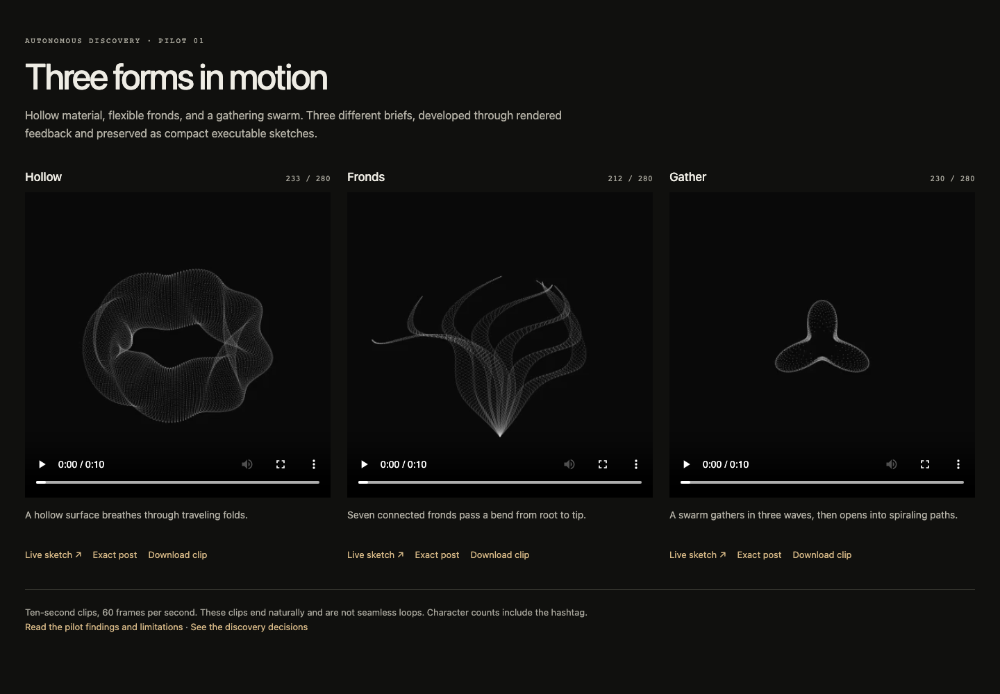

# Autonomous discovery pilot v1

The existing agent completed three different visual briefs with five readable
candidates, two observation-led revisions, and three verified compact posts.
All three receive a **provisional B** from the same model that made them: coherent
studies worth keeping, not exceptional finished work. This supports the feasibility
of the simple discovery loop. It does not establish general reliability or an
independent artistic success rate.

Open [the local gallery](gallery/index.html) for clips and live sketches. Download
or clone this directory first; GitHub's source view does not execute HTML.



## Outcomes

| Brief | Readable candidates | Selected | Compact attempts | Raw / X-weighted characters | Final grade |
| --- | ---: | --- | ---: | ---: | --- |
| Hollow | 1 of 4 | [v1](B01/v1.js) | 1 of 2 | 229 / 233 | B |
| Fronds | 2 of 4 | [v2](B02/v2.js) | 1 of 2 | 208 / 212 | B |
| Gather | 2 of 4 | [v2](B03/v2.js) | 1 of 2 | 226 / 230 | B, lower confidence |

Character counts include `//#つぶやきProcessing`. Every submitted candidate and
revision is preserved, including both rejected v1 candidates. There was no
mid-run human selection, formula correction, or artistic rescue. Continuing the
session and publishing its artifacts are not evidence of human artistic judgment.

**Hollow:** a two-coordinate surface maintains a visible cavity while its tube
breathes and a fold travels around it. Retaining the first candidate was a valid
stopping decision. Its regular toroidal silhouette limits originality.

**Fronds:** the first version had crowded margins and thin material. Shortening
the fronds, moving their common root, and widening their bands repaired the
composition while preserving the traveling bend law. The result is legible and
coherent, but its seven members repeat a familiar gesture.

**Gather:** the first version gathered and released, but mostly read as a generic
pulsing disk. Angular phase cohorts introduced a three-lobed contraction that
opens into differential spiraling paths. The effect is more specific; faint
points and radial ornament still limit its strength.

These changes are supported by the preserved before/after frames and
[decision log](decisions.md). They do not isolate the causal value of visual
feedback: there was no equal-budget comparison without intermediate feedback.

## Verified behavior

The [protocol](protocol.md) was frozen before candidate construction, with its
hash and budgets in [freeze.json](freeze.json). [Selection](selection.json)
preceded character counting. The frozen interval was frames 1–600 at 60 fps on a
400×400 canvas; no brief used a shorter horizon or an extension.

| Check over all 600 frames | Hollow | Fronds | Gather |
| --- | ---: | ---: | ---: |
| Readable/compact maximum coordinate difference | 0 | 0 | 0 |
| Minimum fraction of point centers inside canvas | 100% | 100% | 100% |
| Maximum indexed-point motion, px/frame | 0.234 | 2.333 | 1.295 |
| Full p5.js execution errors | 0 | 0 | 0 |
| Byte-identical sampled PNG pairs | 16/16 | 16/16 | 16/16 |

Motion values above are rounded upward. The limits were 10 px/frame, at least
95% of centers in frame, and at most 1e-7 coordinate difference. The independent
Node execution checked 40,560,000 point calls across readable and compact sources.
It is an independent execution path, not an independent artistic reviewer.

- [verification.json](verification.json): exact-source geometry, motion, length,
  source hashes, and protocol hash.
- [raster-parity.json](raster-parity.json): 48 sampled readable/compact PNG pairs
  are byte-identical in the same browser/runtime.
- [clip-verification.json](clip-verification.json): each MP4 contains 600 frames,
  60 fps, ten seconds, and 400×400 pixels, checked with ffprobe.
- [browser-checks.json](browser-checks.json): each exact post played through the
  entire interval, stopped at frame 600, and passed pause/restart/replay checks.
  The gallery and live pages fit a 390 px viewport without horizontal overflow.

The final sources were rendered in full p5.js 1.11.3 and Chromium 153.0.8010.12.
The three median draw-call times were approximately 5.1, 4.0, and 0.5 ms on the
test machine. These are draw-call timings, not portable performance guarantees.
The clips are lossy H.264 previews; PNG and geometry comparisons use the original
renders. None of the clips is claimed to loop seamlessly.

## Observation and cost limits

The model visually inspected sixteen stills from each of the five readable
versions, selected full-size stills, the three final contact sheets, and desktop
and mobile gallery screenshots. This is sampled visual evidence. Browser playback
and all-frame computational checks do not mean the model visually assessed every
frame of the moving clips. Motion quality remains provisional for this reason too.

The run used 5 of 12 allowed readable candidates and 3 of 6 compact attempts.
Discovery previews captured 80 frames; delivery rendered all 1,800 final frames.
Full final frames remain in local rendering scratch; the archive preserves the
16 review frames per version, final clips, exact posts, and reproducible renderer.
Additional delivery QA is listed in [audit.json](audit.json), including a failed
pause test and its repair. No hidden candidate sweep or compression fallback was
used. Active model time, token usage, and monetary cost were not available.
Wall elapsed time spans session interruptions and tooling work; it is not an
estimate of active discovery effort or proof of efficiency.

The same agent authored the briefs, chose representations, revised, selected,
and graded. The briefs were fresh in this session, but were not independently
held out. All three outcomes count as provisional successes under this pilot's
own rules; that 3/3 is descriptive, not a population estimate. No failure recovery,
representation switch, learned search operator, or global mathematical novelty
was demonstrated.

## Research decision

Keep the existing agent-plus-tools loop as the baseline. It reached compact
delivery across three different representations without the separate search
runtime. This pilot supplies no reason to add a learned judge, larger search
engine, or more filament-specific machinery.

The next experiment should test **whether intermediate rendered feedback improves
the result at a comparable budget**. Freeze fresh briefs and compare the adaptive
loop with candidates written before seeing renders, giving both the same final
selection and compression opportunity. Include harder temporal demands, all
failures, and actual effort. This tests an unresolved capability rather than
collecting another favorable self-grade. Artistic judgments must remain labeled
model-only until independently calibrated.

## Reproduce

From this directory, with Node.js, Playwright/Chromium, and ffmpeg available:

```sh
node verify.mjs
node render.mjs B01/v1.js /tmp/discovery-hollow-readable samples
node render.mjs B01/compact-1.txt /tmp/discovery-hollow-compact clip
node check-gallery.mjs
```

`verify.mjs` uses Node built-ins and the copied repository length checker.
`render.mjs` and `check-gallery.mjs` resolve the installed `playwright` package;
optional `PLAYWRIGHT_MODULE`, `CHROMIUM_PATH`, and `FFMPEG` environment variables
select existing installations. The archived full runtime is local; opening the
gallery needs no remote script. The renderer executes every frame even when it
saves only the sixteen review frames, preserving the compact posts' counters.
Use fresh output directories. The verification scripts regenerate their JSON
reports; browser checks also regenerate screenshots.

To compare renders, use the selected version from `selection.json` for each brief
and compare the sixteen frame filenames in `freeze.json`. Byte-identical PNGs
are expected only with the same browser/runtime/raster environment. Geometry and
length checks do not depend on browser rasterization.

## Dependency provenance

The unmodified [p5.js 1.11.3 runtime](https://cdn.jsdelivr.net/npm/p5@1.11.3/lib/p5.min.js)
has SHA-256 `af51e6211e061b5ae463fbc5c3c1c272e5ca67fa560ed3513fde17325d837506`.
Its [upstream source](https://github.com/processing/p5.js/tree/v1.11.3) and bundled
[LGPL 2.1 license](p5-LICENSE.txt) identify the dependency separately from the
original pilot sketches. `check-length.mjs` is copied unchanged from
`scripts/check-length.mjs` at base commit
`490150a124ef232c718b7eb4974d563aa69d0373`.
