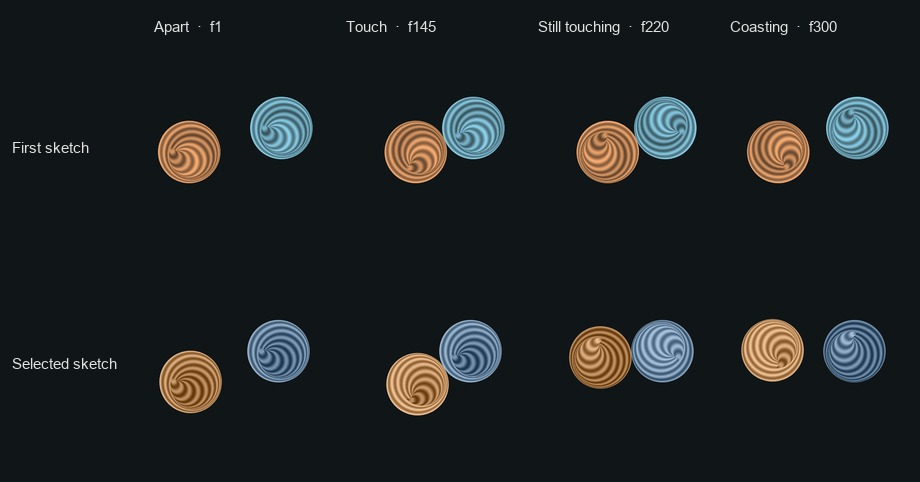

# Visual selection

**V2, provisional B.** Follow the small curl inside the blue whorl. It holds its bearing while copper approaches, turns as copper climbs its rim, and keeps turning across the dark gap. The band of light moving through each curl makes its rotation easy to follow. Both whorls use the same stack of eccentric discs. I would keep this as a kinetic study. On the second encounter the copper follows the same arc, which makes the piece predictable. [Selected sketch](v2.js)

**V1, provisional C.** The blue whorl picks up the turn, but the copper centre parks for the duration of contact. The two spinning discs read like a drive diagram. V2 lets copper travel along the rim during transfer and gives the ridges a fixed light. Both changes were made together. [First sketch](v1.js)

I compared full-size renders, sixteen samples spanning each twelve-second clip, and quarter-second samples of each encoded first encounter. The stills below show matched frames. I authored and graded both sketches. The two readable slots are spent. This selection precedes compact code and character counts. The selected source SHA-256 is `08814dd69fe051c255df1f91ecd3b9fb8e2065583b28cc8d6ae046c521b71374`.

