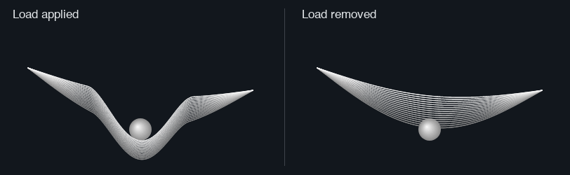

# Pearl and silk

The pearl makes a pocket in a suspended ribbon, carries it sideways, and lifts away. The selected sketch earned a provisional **B**. Its shorter compact attempt reproduced the animation exactly in the test browser but used **316 of 280 weighted characters**. The experiment ended with zero qualifying posts. [Watch the twelve-second readable animation](readable.mp4?raw=1) · [Selected p5.js source](v2.js)

## What made the ribbon move

At peak contact the pearl pushed the centre of the silk down 64 pixels. With the clock held at frame 90, moving the pearl 40 pixels to the right moved the deepest part of the pocket from x = 200 to x = 240. Its depth stayed at 64 pixels. Both ends held.



Removing just the load term kept the pearl on exactly the same path. All 358 loaded frames changed. All 358 separated frames and the four frames at the contact boundary stayed byte-identical. This establishes positional coupling in the drawing rule. The pearl follows a prescribed orbit, and the silk returns to rest immediately on release. [Reproducible contact check](check-contact.mjs)

## Selection and compression

The first sketch's straight upper edge looked like a rigid tray when the pearl lifted. The full-size stills and first-orbit sequence informed the revision. Its twelve-second review sheet was generated then and inspected at final verification. The revision gave the silk a resting bow, spaced its threads farther apart, and used the same silver tones for the two materials. The authoring agent chose and graded it before either compact attempt. No human chose the sketch. The immediate recovery and the repeated orbit limited the sense of weight after release. [Frozen brief](brief.md) · [Visual selection and both review sheets](selection.md)

| Complete attempt | Raw characters | X-weighted characters | Verification |
| --- | ---: | ---: | --- |
| [Shared point projection](attempt-1.txt) | 326 | 330 | Parsed and measured |
| [One loop for each pearl layer and its thread](attempt-2.txt) | 312 | 316 | Parsed, measured, and compared over 720 frames |

All 720 PNG pairs for the second attempt were byte-identical. Across 10,272 indexed points per frame, coordinate differences stayed below 6 × 10⁻¹⁴ pixels, and the drawing styles matched exactly. The selected readable also started and drew in a normal p5 page. Both readable slots and both compact attempts were used. [Verification record](result.json)

## Reproduce

Run these commands from this directory. The length checker returns status 1 for the overlength attempt. The numerical auditor reports an overall failure on length. Its coordinate and style errors are recorded separately.

```sh
node check-contact.mjs
node ../../scripts/check-length.mjs attempt-2.txt
output_dir=$(mktemp -d)
node ../compact-preflight-v1/audit-source.mjs v2.js attempt-2.txt "$output_dir/audit.json"
node ../compact-preflight-v1/render.mjs v2.js "$output_dir/readable" clip
node ../compact-preflight-v1/render.mjs attempt-2.txt "$output_dir/shortest" clip
for png in "$output_dir"/readable/[0-9]*.png; do
  cmp "$png" "$output_dir/shortest/${png##*/}" || exit 1
done
```

The browser commands use Playwright, Chromium, FFmpeg, and the sibling pilot's pinned p5.js 1.11.3. The renderer accepts `PLAYWRIGHT_MODULE`, `CHROMIUM_PATH`, and `FFMPEG` for custom installations.
