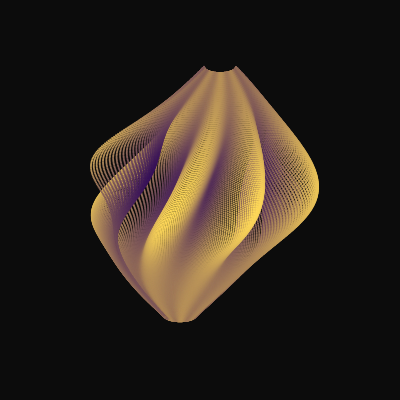

# Pleated lantern

A band of deep folds travels down a hanging lantern. Gold ridges swell into the outline, turn violet in the valleys, and settle into shallow creases as the band passes. One fold value controls both the radius and the light on the surface.

[](lantern.mp4?raw=1)

[Watch the clip](lantern.mp4?raw=1) · [Copy the exact p5.js post](attempt-2.txt) · [Read the selected sketch](v2.js)

## Selection and compression

The [brief](brief.md) allowed two readable sketches and two compact attempts. In the [first sketch](v1-review.jpg), sections between pulses looked flat. The revision kept a shallow crease in the resting material and sampled the surface more densely. The traveling fold stayed legible through the broad middle of the lantern. At full expansion some outer ribs still break into a visible mesh. The authoring agent selected the revision and graded it **B**, a study worth keeping. The [selection record](record.json) and [sixteen-frame review](v2-review.png) were committed before the first count. No human chose or corrected the artwork.

| Complete post, including hashtag | Raw characters | X-weighted | Outcome |
| --- | ---: | ---: | --- |
| [Mechanical minification](attempt-1.txt) | 302 | 306 | Parsed, over budget |
| [Manual compression](attempt-2.txt) | 276 | **280** | Delivered |

The first attempt used the [mechanical minifier from PR #143](https://github.com/p-toni/tsubuyaki-processing/blob/6927be1156a198971f0ef05e63339aa07b762d50/experiments/compressibility-forecast-retrospective-v1/forecast-length.mjs). The second folded canvas setup into the first draw and used a frame counter and a shorter loop. It retained the same fold, radius, lighting, point order, and projection. This recovered 26 weighted characters without dropping a visual feature.

## Verification

The readable and the exact post drew 46,080 points per frame. Across 720 frames the maximum coordinate and drawing-style differences were both zero. All 720 pairs of 400 × 400 PNGs were byte-identical in Chromium with p5.js 1.11.3. The exact post also started and advanced in a normal p5 page. Its encoded clip contains 12 seconds at 60 fps. The compact draw took a median 34.7 ms per frame on the verification machine, so live playback speed depends on the device. Source hashes, sequence digests, render timings, and video metadata are in the [verification record](result.json).

From this directory, with Node.js, Playwright, Chromium, and FFmpeg available, reuse the existing study tools. The renderer accepts `PLAYWRIGHT_MODULE`, `CHROMIUM_PATH`, and `FFMPEG` for custom installations.

```sh
out=$(mktemp -d)
node ../autonomous-discovery-pilot-v1/check-length.mjs attempt-2.txt
node ../compact-preflight-v1/audit-source.mjs v2.js attempt-2.txt "$out/audit.json"
node -e "require('node:assert/strict').equal(require(process.argv[1]).pass, true)" "$out/audit.json"
node ../compact-preflight-v1/render.mjs v2.js "$out/readable" clip
node ../compact-preflight-v1/render.mjs attempt-2.txt "$out/post" clip
for png in "$out"/readable/[0-9]*.png; do
  cmp "$png" "$out/post/${png##*/}" || exit 1
done
```
