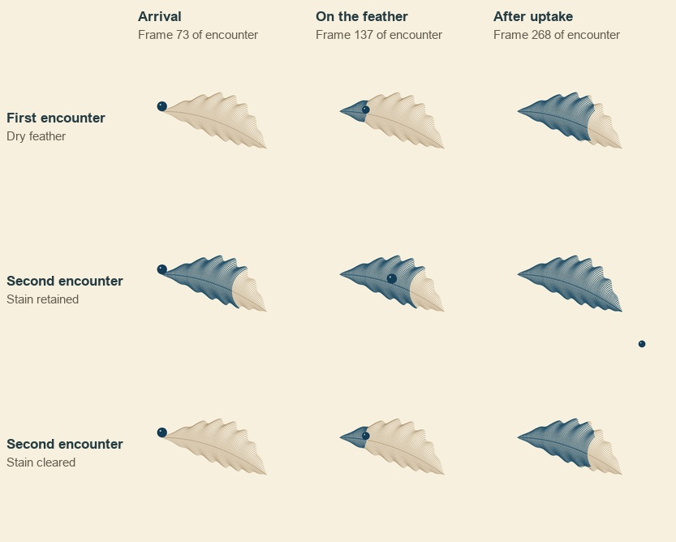

# Thirst

Two equal drops of ink land on a feather. The first travels partway down the shaft and disappears into the barbs. The second crosses the blue section faster, stains the remaining dry fibers, and falls from the tip with half its ink. [Watch the 12-second film](thirst.mp4?raw=1) · [Readable sketch](v2.js) · [Executable sketch](attempt-1.txt)

The brief asked for a second encounter visibly changed by the first. The agent chose the feather, ink, and uptake rule. **Provisional B.** In the first sketch a whole barb changed colour at once. Letting the dye climb from the shaft toward the tips gave the stain a life of its own. The falling bead still looks like a marble. The authoring agent selected and graded the work before compression. [Brief](brief.md) · [Selection and first sketch](selection.md)

## What the feather kept

Each drop arrives with 64 units of ink. Each of the 96 pairs of barbs can take up one unit. The feather records the frame a pair first became wet. That record tells the drop where it can roll freely and gives each blue stroke time to spread.

| Encounter | Wet pairs at arrival | Ink past the tip | What happened |
| --- | ---: | ---: | --- |
| First | 0 | 0 | Drop disappeared at frame 244 of the encounter |
| Second | 64 | 32 | Drop passed the tip at frame 244 |
| Second with stain cleared | 0 | 0 | First encounter replayed exactly |
| Second with 48 wet pairs retained | 48 | 16 | Drop passed the tip at frame 266 |

For the reset, we emptied only the stain record just before the second dose at frame 361. All 360 subsequent PNGs matched the corresponding frames of the first encounter byte for byte. With the stain retained, the second drop was already 64.8 pixels farther along at matched frame 137. The 48-pair test measured the drawn drop in a program replay. [Run the memory test](check-memory.mjs) · [Full measurements](result.json)

## What compression cost

| Complete sketch including hashtag | Raw code points | X-weighted characters | Readable PNGs reproduced |
| --- | ---: | ---: | ---: |
| Published film | 630 | 634 | 720/720 |
| Shaft line and bead highlight removed | 539 | 543 | 0/720 |

The shorter attempt preserved the position and amount of ink in every frame, and its reset also reproduced its own first encounter. With the central line gone, the drop appears to cross a field of parallel strokes. I kept the longer version because the shaft makes the route visible, especially on the already-blue feather. Both versions are well above the 280-character target. Since the two marks were removed together, this comparison gives no individual cost or grade for the highlight. [Shorter attempt](attempt-2.txt)

Both complete sketches ran in ordinary p5 playback and matched their reference frames before contact, during uptake, and after release. The film uses the published sketch in p5.js 1.11.3 at 400 × 400 and 60 fps. The two readable slots and both compact attempts were used. [Frame renderer](../compact-preflight-v1/render.mjs)

From the repository root, `node experiments/second-encounter-v1/check-memory.mjs` replays the retained, cleared, and partial stains. To reproduce the cleared render, insert `if (frameCount === 361) A.length = 0;` at the start of the executable sketch's `draw` and render frames 1 through 720 consecutively.
